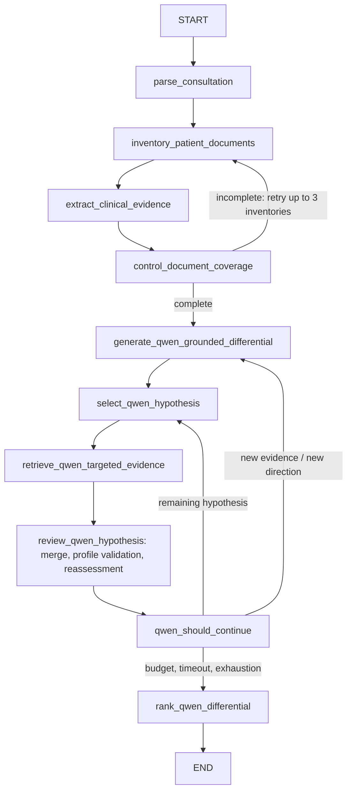

# Rapport — refonte du moteur d'investigation clinique

Date : 26 octobre 2026

## Résumé

Le flux `qwen_grounded` conserve maintenant chaque phrase source, relie les faits structurés à cette source, fusionne les résultats Qdrant vérifiés dans l'état LangGraph et les expose à la revue suivante. Le référentiel médical local est transmis à la génération et à la revue. Les relations retenues par le LLM sont filtrées par une validation Python fondée sur ces profils. Les hypothèses peuvent être revues après changement de version des preuves; la boucle et les appels restent bornés. Un échec de comparaison produit des hypothèses non départagées et un statut d'erreur, au lieu de valider implicitement l'ordre d'origine.

Le moteur reste un prototype d'aide à la réflexion clinique. La validation des relations est déterministe et limitée aux termes du référentiel local; elle ne constitue pas une validation médicale indépendante complète.

## Schémas

Avant :

```text
START -> parse -> inventory -> extract -> generate 5 hypotheses
      -> select -> Qdrant search -> Qwen review -> next hypothesis
      -> compare (failure could retain original order) -> END
```

Après (`qwen_grounded`) :



Le workflow ne comporte pas de nœuds LangGraph séparés nommés `MERGE_NEW_EVIDENCE`, `RETRIEVE_MEDICAL_KNOWLEDGE`, `VERIFY_EVIDENCE`, `CHALLENGE_HYPOTHESIS` et `UPDATE_HYPOTHESIS`: ces opérations sont réalisées dans les nœuds Qwen ciblés et dans le validateur Python. Le contrôle de couverture reste un nœud distinct.

## Modifications principales

- `app/investigation/evidence.py` : suppression du rejet des passages `OTHER`; conservation des phrases originales dans `RawClinicalEvidence`; structuration de chaque phrase et lien `raw_evidence_id`; prise en charge des examens non réalisés et des durées.
- `app/models/investigation.py`, `app/models/__init__.py` : ajout des types de concept, relation, preuve brute/structurée, métadonnées de couverture et statut de comparaison.
- `app/investigation/state.py` : état pour les chunks, nouvelles preuves, historique, révision des preuves, génération et références rejetées.
- `app/investigation/graph.py` : l'inventaire autoritatif parcourt tous les chunks du patient indépendamment du top-k Qdrant; couverture incomplète renvoie à l'inventaire jusqu'à trois tentatives, puis produit un résultat partiel sans générer de diagnostic; réinjection Qdrant patient-scopée et dédupliquée; revue sur le nouvel état; connaissances locales injectées; boucle de sélection/réévaluation bornée; comparaison retry deux fois au maximum, erreurs consignées, rang `0` si échec.
- `app/investigation/validation.py` : validation des sources vérifiées, de leur polarité, de leur lien avec les critères du profil et classement des tests non réalisés comme manquants. Les liens proposés sans profil ou sans correspondance deviennent incertains.
- `app/investigation/knowledge.py`, `app/container.py` : correspondance explicite nom/alias et activation du service médical en mode `qwen_grounded`.
- `app/agents/local_gguf.py` : profils médicaux fournis aux prompts; filtrage des concepts `FINDING` comme hypothèses; tentative de réparation JSON structurelle; erreur de validation journalisée; validation exacte de l'ensemble comparé.
- `app/core/config.py` : champ `evidence_verifier_model` réservé à une future configuration de modèle spécialisé; aucun second modèle ni Jeva-9B n'est chargé.
- `app/services/investigation_service.py`, `frontend/app.py` : exposition et affichage de la couverture des passages, de la validité des relations, de l'état de l'investigation et séparation des constatations/hypothèses. Les rangs nuls apparaissent comme non départagés.
- `tests/test_investigation_refactor.py`, `tests/test_clinical_investigation.py` : tests de conservation, examens manquants, relations non pertinentes, réparation JSON, échec de comparaison, réinjection patient-scopée et réévaluation après preuve discriminante.
- `app/storage/repository.py`, `app/api/investigation.py` : registre client persistant, migration des patients déjà présents dans les documents, création explicite et recherche partielle.
- `app/ingestion/loader.py`, `app/services/document_service.py`, `app/api/documents.py` : import d'archives ZIP en mémoire, garde-fous de chemin, chiffrement, nombre de fichiers et volume décompressé; chaque PDF/TXT/Markdown extrait passe par l'import habituel et est indexé dans Qdrant.
- `frontend/app.py` : autocomplétion par requête et liste de suggestions client, création de dossier, upload ZIP, suivi des événements/constats/investigations récents et prompts de démonstration réutilisables.
- `tests/test_ingestion.py`, `tests/test_api.py` : archives traversantes rejetées, types autorisés importés/indexés, client sans documents, recherche et tableau de bord.
- `app/models/investigation.py`, `app/investigation/graph.py`, `frontend/app.py` : taux d'étayage documentaire par hypothèse. Formule affichée et traçable : `100 × preuves favorables / relations (favorables + contradictoires + incertaines + manquantes) × couverture des passages`. Ce taux décrit les relations de preuve retenues et n'est pas calibré comme une probabilité diagnostique.

## Preuves et limitations

- Le code d'extraction garde chaque phrase; la déduplication compare l'identifiant stable puis les ensembles de termes normalisés. Le seuil Jaccard de 0,9 évite certains doublons de formulation, mais ne remplace pas une résolution sémantique complète.
- Le graphe construit son inventaire depuis le dépôt patient et charge initialement ses chunks; la recherche ciblée reste utile pour exposer des passages retrouvés et enrichir un état partiel. Dans un dossier déjà entièrement inventorié, une recherche ciblée peut légitimement ne produire aucune nouvelle preuve.
- Les profils sont indépendants des documents du patient, mais constituent une base locale de couverture limitée. Un nom généré qui ne correspond ni à un nom ni à un alias ne reçoit pas de profil médical explicite et ne peut donc pas obtenir de relation positive/contradictoire confirmée par ce validateur.
- La validation de temporalité n'est pas une comparaison clinique complète de la chronologie: elle se limite actuellement à la présence d'une date sur la preuve. Les dates relatives et les fenêtres de validité d'examens restent à traiter.
- La réparation JSON couvre les objets tronqués et virgules terminales simples; elle ne répare pas une sortie sémantiquement incohérente. Les erreurs de comparaison restent visibles et non départagées.
- La configuration réservée au modèle de vérification n'est pas encore câblée; aucune vérification par second LLM n'est prétendue.
- `coverage.complete` exige désormais que les passages patient inventoriés soient examinés, en plus des contrôles documentaires et de provenance.

## Tests

Commande exécutée dans `.venv` :

```powershell
.\.venv\Scripts\python.exe -m pytest -q --tb=short
```

Résultat final : **41 tests passés**. `py_compile` passe sur les modules modifiés. Un avertissement de dépréciation Starlette/AnyIO est émis par une dépendance; aucun échec.

Les tests utiles existants ont été conservés et étendus plutôt que supprimés. La suppression des caches générés (`.pytest_cache`, `.ruff_cache`, `__pycache__`) a été tentée en restant dans le workspace, mais l'outil d'approbation automatique a refusé l'opération récursive; ces caches restent ignorés par `.gitignore`.

## Évaluation `client_test-1`

Le résultat sauvegardé avant cette refonte (`inv_72d3e6bde52c416a8c6211c4e1de271e`) fournit la baseline suivante :

| Mesure | Avant |
|---|---:|
| Documents examinés | 8 / 8 |
| Passages/chunks présents dans l'état | 8 |
| Faits structurés | 22 |
| Itérations | 5 |
| Hypothèses générées / revues | 5 / 5 |
| Appels LLM | 8 |
| Comparaison | non aboutie (`{}`) |
| Durée | 469,885 s |

Une première tentative d'initialisation du conteneur a essayé une vérification réseau Hugging Face et a échoué. Le modèle était bien présent dans le cache : le chargement isolé fonctionne avec `HF_HUB_OFFLINE=1`. Le lancement direct du conteneur a ensuite échoué car l'instance API active détenait déjà le verrou Qdrant. L'investigation a alors été lancée via cette API et a été sauvegardée (`inv_9bce773af9274390a8ad79315407f171`), mais sa réponse prouve que le serveur n'a pas rechargé le code modifié : elle n'expose pas les champs `raw_clinical_evidence`, `retrieved_chunks`, `evidence_history` ou `comparison_status`, et renvoie encore 22 faits, 5 hypothèses, 8 appels et une comparaison absente. Cette exécution confirme le comportement de l'ancienne instance, pas le code source refactoré. Les fichiers cache ont une cible locale valide; c'est le mode de résolution en ligne, pas une absence du modèle, qui a provoqué la première erreur.

| Mesure | Avant, résultat persisté | Appel API après modifications |
|---|---:|---:|
| Documents examinés | 8 / 8 | 8 / 8 |
| Passages | 8 chunks | champ non exposé par l'instance ancienne |
| Faits structurés | 22 | 22 |
| Passages bruts | non stockés | champ absent |
| Preuves nouvelles | 0 observées | 0 observées |
| Itérations | 5 | 5 |
| Hypothèses générées | 5 | 5 |
| Hypothèses avec compteur de revue | 5 examinées dans l'état baseline | champ absent |
| Appels LLM | 8 | 8 |
| Comparaison | `{}` / non aboutie | champ absent; aucune comparaison affichée |
| Durée | 469,885 s | 537,257 s |

La comparaison n'est pas valide comme mesure de la refonte, puisque l'API n'a pas chargé les nouveaux modules. Il faut redémarrer explicitement le backend dans un environnement avec `HF_HUB_OFFLINE=1`, puis répéter l'investigation avant de mesurer le comportement post-refonte. Aucun réindexage de documents patient n'a été effectué.

**Écart au protocole de test aveugle :** lors d'une recherche `rg` de contrôle des références aux corrigés, la sortie a exposé une ligne de `tests/evaluation/ground_truth.json` avant qu'un nouveau résultat soit généré et sauvegardé. Cette consultation prématurée est une erreur de procédure. Le contenu n'a pas servi à modifier le code, les prompts, les tests ou le classement; aucun résultat post-refonte n'a été produit et le fichier n'a pas été rouvert pour évaluer le moteur. Une future évaluation aveugle devra repartir d'un processus distinct et consigner le résultat avant l'accès au corrigé.

## Limites restantes

1. La sémantique des critères médicaux dépend du vocabulaire et de la couverture des profils locaux; les rapprochements lexicaux peuvent manquer des synonymes ou des liens cliniques indirects.
2. La chronologie, la temporalité des examens et la polarité nécessitent une validation clinique plus riche; les inconnues doivent rester incertaines.
3. Le nouveau test d'intégration réel avec Qwen n'a pas été possible faute de snapshot d'embeddings utilisable hors ligne. Les tests automatisés utilisent un faux LLM pour le graphe et ne valident pas la qualité clinique du modèle Qwen.
4. Le contexte complet est transmis au LLM dans les limites de la fenêtre et du budget configurés; aucune mesure empirique de troncature du prompt n'a été obtenue pendant cette tentative bloquée.
5. L'ordre final reste une comparaison générée par Qwen puis vérifiée sur l'ensemble exact des noms; ce n'est pas une calibration probabiliste.
